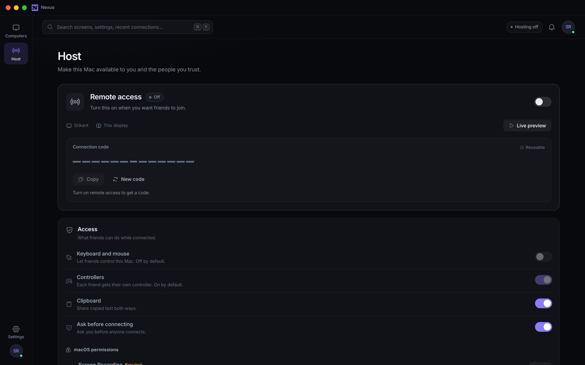

<div align="center">

# Nexus

<p>
  A macOS remote desktop with hardware HEVC, encrypted peer-to-peer transport, and per-friend controller seats.<br>
  Four virtual pads have been enumerated simultaneously through OpenJoystickDriver; a full five-player session has not yet been tested.
</p>


<p>
  <a href="#download">Download</a>
  ·
  <a href="#quick-start">Quick start</a>
  ·
  <a href="#how-it-works">How it works</a>
</p>



<sub>Host screen, web preview. Screen Recording and other native permissions only appear in the macOS app.</sub>

</div>

> [!IMPORTANT]
> macOS 12.3 or newer is required on **both** Macs. The application is ad-hoc signed, not notarized, and has no account system: the first launch creates a local profile and all pairing is by invite code. Screen Recording, Accessibility, and Input Monitoring are granted by the host in System Settings. Controllers additionally require [OpenJoystickDriver](https://github.com/srikanthamsa/sunshine-macos-gamepads) to be running; four remote pads is its current limit.

> [!WARNING]
> There is no audio, file transfer, HDR, virtual display, or persistent friend list. Four controller seats are the verified part; five-player gameplay, eight concurrent viewers, and CrossOver/Wine hosting are untested. See [Limits](#limits).

> [!NOTE]
> Nexus is an independent clean-room project. It is not affiliated with, endorsed by, or derived from Parsec Technologies. “Parsec” is a trademark of its respective owner. No public license is granted for this repository.

## Download

There is no signed public release yet. Build the DMG from source with [Quick start](#quick-start), then install it:

```sh
open src-tauri/target/release/bundle/dmg/Nexus_0.1.0_aarch64.dmg
```

Drag **Nexus** to `/Applications`, then open it once and grant Screen Recording before turning on remote access.

## What works

| Capability | Status |
| --- | --- |
| ScreenCaptureKit capture + VideoToolbox HEVC encode on macOS | Implemented |
| Noise XX-encrypted TCP session with host approval | Implemented |
| WebRTC RTP/UDP video path with automatic TCP fallback | Implemented |
| Hardware HEVC decode into a native Metal layer | Implemented |
| Tailscale-aware join code (`PC1-…`) and nearby-host discovery | Implemented |
| Per-viewer keyboard, mouse, clipboard, and controller switches | Implemented |
| Multi-viewer presence and two-minute approval requests | Implemented |
| Four remote virtual pads through OpenJoystickDriver | **Verified** — 4/4 pads enumerated in one live test |
| Five-player gameplay end to end | Untested |
| Eight concurrent viewers under load | Untested |
| Audio capture, playback, and routing | Not supported |
| Accounts, friend lists, and team management | Not supported |
| File transfer, HDR, virtual displays, all-display sharing | Not supported |
| CrossOver/Wine host or guest | Untested |

“Implemented” means the code path exists and has automated coverage, not that it has been exercised between two physical Macs in every network condition.

## Quick start

Prerequisites: macOS 12.3+, Xcode Command Line Tools, Rust stable, Node.js 20+ and access to the private repository.

```sh
git clone https://github.com/srikanthamsa/nexus.git
cd nexus
npm ci
npm run tauri build
open src-tauri/target/release/bundle/macos/Nexus.app
```

The first launch creates a local profile. Open **Host**, grant Screen Recording, turn on **Remote access**, copy the connection code, and send it to the other person. They paste it under **Connection code** and you approve the request.

If you prefer an app bundle over launching from the build directory, mount the DMG produced by the same build:

```sh
open src-tauri/target/release/bundle/dmg/Nexus_0.1.0_aarch64.dmg
```

### First run

1. Launch **Nexus**. Enter a display name; this is a local profile and is never sent to a server.
2. Open **Host** and grant **Screen Recording** when macOS asks. Reopen the app after granting it; macOS caches the permission at launch.
3. Turn on **Remote access** and copy the **Connection code**. The code includes the host address and the current approval token.
4. On the other Mac, open **Computers → Connect with a code**, paste the code, and send the request.
5. Approve the request on the host. The viewer then appears in the presence dock with independent keyboard, mouse, clipboard, and controller switches.
6. For controllers, start **OpenJoystickDriver** first and grant **Input Monitoring**. Controllers are on by default; keyboard and mouse are off by default.

The host’s physical controller is player 1. Remote controller seats use the lowest free slot, up to four, for five players total when the host is using a pad.

## How it works

```text
 Host Mac                                      Viewer Mac
 +----------------------+   Noise / TCP :39200  +----------------------+
 | ScreenCaptureKit     | --------------------> | Noise + approval     |
 | VideoToolbox HEVC    |   RTP / UDP :39201    | Metal HEVC decode    |
 | CGEvent / OJD pads   | <-------------------- | keyboard / gamepad   |
 +----------------------+                       +----------------------+
```

- Capture, encode, and the preview pipeline live in `src-tauri/src/engine.rs` and `src-tauri/src/video.rs`.
- The Noise-authenticated TCP session, pairing, and control channel are in `src-tauri/src/transport.rs`, `src-tauri/src/host.rs`, and `src-tauri/src/client.rs`.
- WebRTC signaling, RTP video, congestion control, and fallback are in `src-tauri/src/webrtc_transport.rs`.
- Pairing codes and Tailscale-aware address selection are in `src-tauri/src/join_code.rs` and `src-tauri/src/reachability.rs`.
- Host input injection and controller passthrough are in `src-tauri/src/input.rs`, `src-tauri/src/gamepad.rs`, and `src-tauri/src/ojd.rs`.
- The desktop UI and native command bridge are in `src/App.tsx`, `src/screens/`, and `src/lib/native.ts`.
- The self-hostable relay is a separate crate under `relay/`; it forwards opaque bytes and never receives pairing codes or media keys.

## Troubleshooting

| Symptom | Cause | Fix |
| --- | --- | --- |
| Host says “Could not read this Mac’s displays” | Screen Recording permission was never granted, or was revoked after a rebuild | Remove and re-add Nexus in **System Settings → Privacy & Security → Screen Recording**, then relaunch |
| Friend’s connection times out | Remote access is off, the Mac firewall is blocking Nexus, or Tailscale is not running | Confirm **Host → Remote access** is Live, allow incoming Nexus connections, and check `tailscale status` on both Macs |
| Connection falls back to TCP | UDP 39201 is blocked or the network is CGNAT | This is supported; inspect the path in the HUD. Fix UDP forwarding only if you need the lower-latency path |
| “The service already runs 4 virtual gamepads” | Four OJD pads are already active | Close the stale OJD/Sunshine session or release a pad; Nexus does not create a fifth remote pad |
| Controllers do not appear | OpenJoystickDriver is not running, its token is missing, or Input Monitoring is denied | Start OJD, confirm its endpoint/token, and grant Input Monitoring to Nexus |
| Approval is requested again | The previous request expired or the invite code was rotated | Copy the current code from the Host screen and approve the new request |
| App cannot be opened after download | Ad-hoc signature and no notarization | Right-click **Open**, or run `xattr -dr com.apple.quarantine /Applications/Nexus.app` |
| No audio | Audio is not implemented in this build | Use another audio path; do not expect system audio in the stream |

## Limits

- **Audio is missing entirely.** No microphone, system audio, or playback routing.
- **Five-player gameplay is not verified.** OJD supports four remote pads and the host’s physical controller is player 1; the complete controller + video + approval flow has not been played through with five people.
- **Eight viewers are implemented, not benchmarked.** Each viewer currently runs its own capture and HEVC encoder, so load and thermal behavior are not known.
- **No accounts or friend list.** Invite codes are the only identity and authorization mechanism.
- **No manual STUN/TURN/relay setup in the UI.** Tailscale or a directly reachable address is the supported internet path; the relay crate exists but has not been field-tested across two networks.
- **No file transfer, HDR, virtual displays, or all-display sharing.**
- **CrossOver and Wine are untested.** OJD may not be visible to a Wine-hosted game.
- **The build is ad-hoc signed and not notarized.** macOS may quarantine it; rebuilding invalidates Screen Recording because the binary identity changes.
- **No repeatable performance table yet.** The HUD reports live frame rate, bitrate, jitter, RTT, and dropped frames; one cross-city observation is not enough to publish a hardware-attributed benchmark.

## Credits

Built with [Tauri](https://tauri.app/), [React](https://react.dev/), [Rust](https://www.rust-lang.org/), Apple’s [ScreenCaptureKit](https://developer.apple.com/documentation/screencapturekit), [VideoToolbox](https://developer.apple.com/documentation/videotoolbox), and [Metal](https://developer.apple.com/metal/).

Transport and crypto work uses [webrtc-rs](https://github.com/webrtc-rs/webrtc) and [snow](https://github.com/mcginty/snow). Controllers depend on [OpenJoystickDriver](https://github.com/srikanthamsa/sunshine-macos-gamepads). Tailscale is used for address selection, not bundled. Interface icons are [Phosphor Icons](https://phosphoricons.com/); type is [Inter](https://rsms.me/inter/).

The `relay/` crate declares MIT in its `Cargo.toml`. The application itself has no public license; the repository is private. No affiliation or endorsement by Parsec Technologies is claimed.
